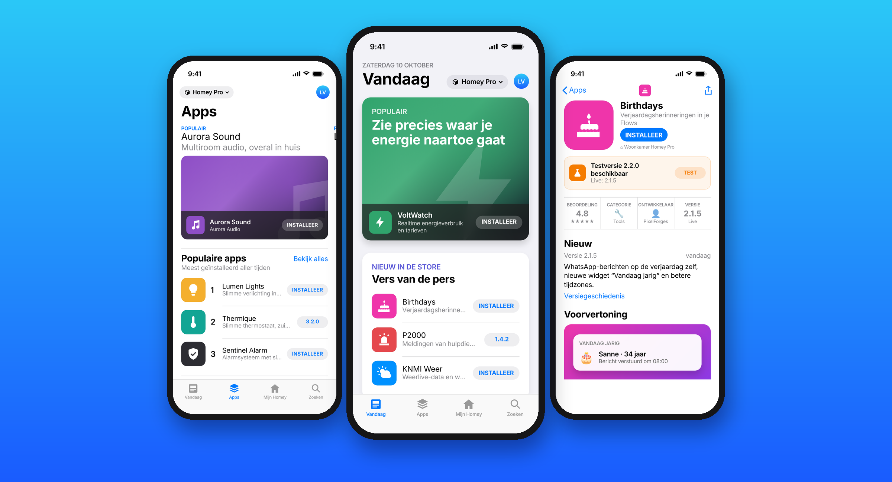
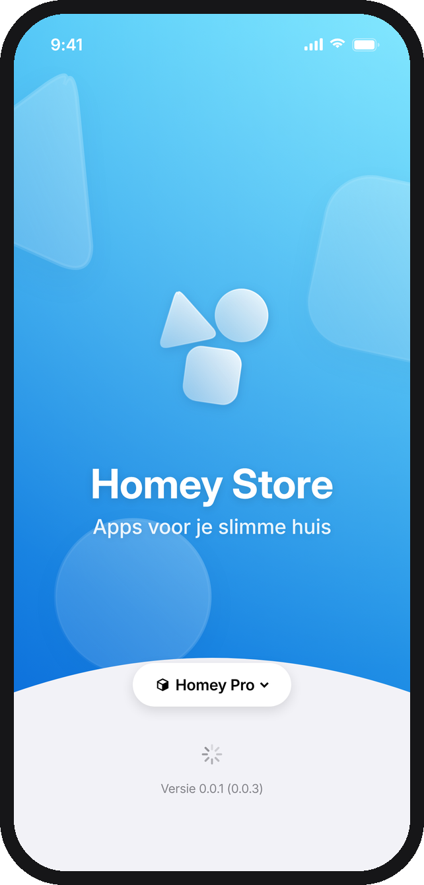
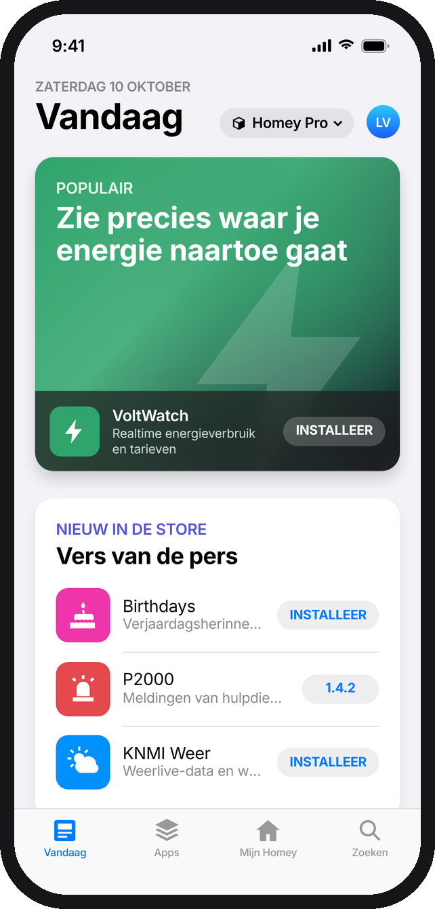
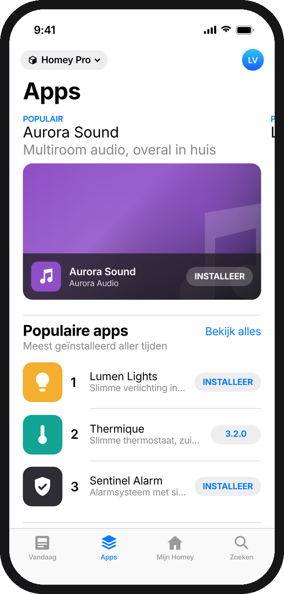
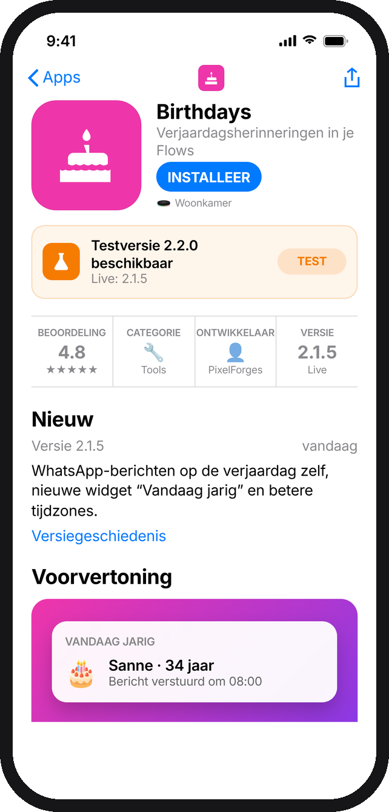
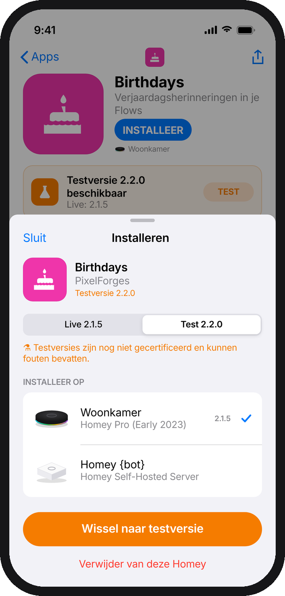
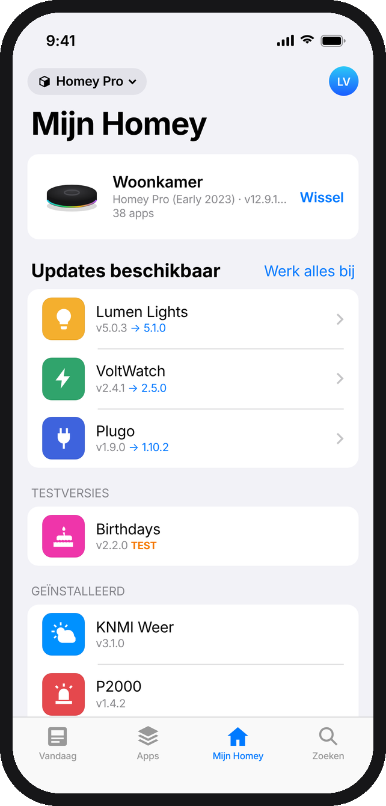
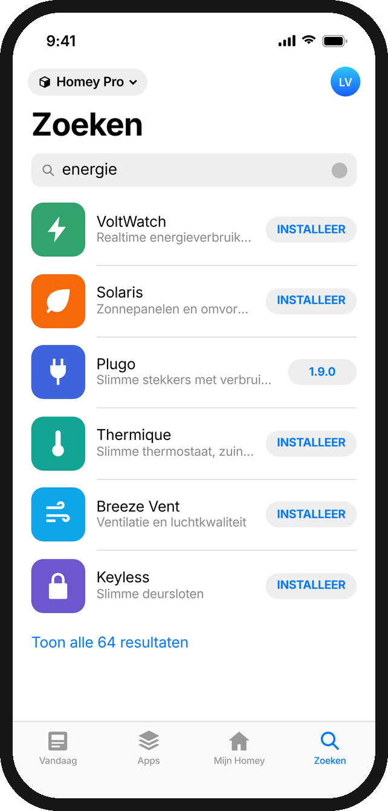
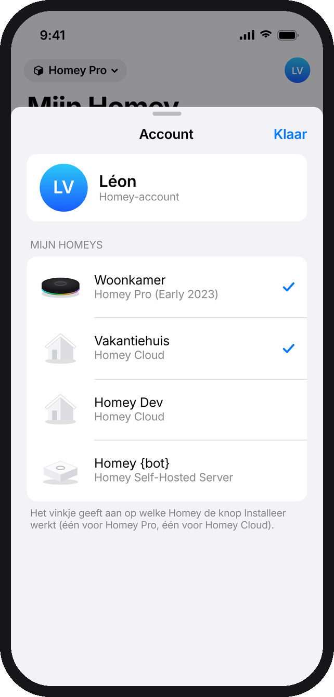
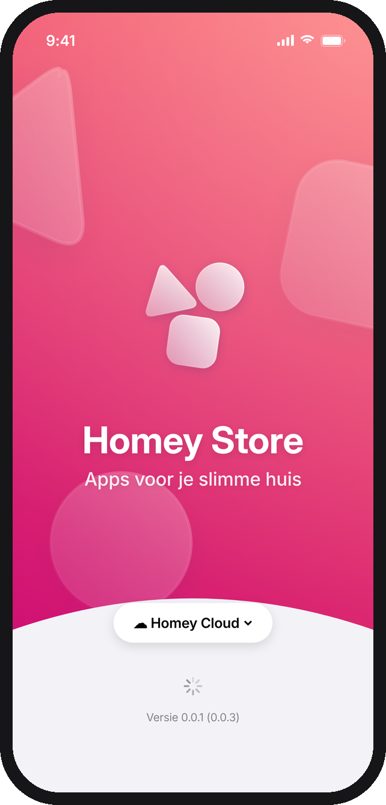

  

<h1 align="center">Homey Store</h1>

  The Homey App Store in the look of the iOS App Store — browse apps for Homey Pro and Homey Cloud and install them straight onto your Homey, including test versions.

  
  
  

  

---

## Screenshots

<table>
  <tr>
    <td align="center"> <b>Splashscreen (Homey Pro)</b></td>
    <td align="center"> <b>Vandaag</b></td>
    <td align="center"> <b>Apps</b></td>
  </tr>
  <tr>
    <td align="center"> <b>App-pagina met testversie</b></td>
    <td align="center"> <b>Installeren: Live of Test</b></td>
    <td align="center"> <b>Mijn Homey</b></td>
  </tr>
  <tr>
    <td align="center"> <b>Zoeken</b></td>
    <td align="center"> <b>Mijn Homeys</b></td>
    <td align="center"> <b>Splashscreen (Homey Cloud)</b></td>
  </tr>
</table>

Screenshots zijn ontwerpweergaven met voorbeeld-apps.

## What it does

| | |
|:--|:--|
| **Splash screen** | In the style of the Homey App Store on homey.app: the store gradient (blue for Homey Pro, pink for Homey Cloud) with drifting frosted shapes, the app mark and a curved panel with the store choice, while the store front preloads. |
| **Two stores** | Switch between **Homey Pro** (Pro, Pro mini, Self-Hosted Server) and **Homey Cloud** from the menu top-left — same as the tabs on homey.app/apps. |
| **Vandaag** | Editorial cards like the App Store Today tab: popular, new, just updated, energy, security. |
| **Apps** | Swipeable feature cards, ranked shelves (popular, new, updated, top per category) and all categories. |
| **Zoeken** | Live search with recent searches, suggestions and categories. |
| **App page** | Icon, Install button, info strip (rating, category, developer, version, drivers, Flow cards, SDK), What's New, version history, preview, description, devices it works with, information and links. |
| **Install** | App Store–style sheet: choose the Homey, choose **Live** or **Test**, install — with progress, update / switch-channel / reinstall / remove. |
| **Test versions** | Apps with a test build show an orange banner and a *Testversie* section; install the test or share the test link. |
| **Mijn Homey** | Apps installed on your Homey with available updates (*Werk alles bij*), test installs and CLI dev installs. |
| **Mijn Homeys** | Your Homeys with the same product images as my.homey.app (Homey Pro, Pro mini, Cloud, Self-Hosted Server — light and dark), and which one the Install button targets per store. |
| **Accounts** | Log in like Homey Dev (Homey login or Personal Access Token), multiple saved accounts, quick switching, sign out. |

## Design

The app icon and splash take their cue from the Homey App Store header on homey.app: the 60° store gradient (`#005CD5 → #52DEFF` for Homey Pro, `#C70076 → #FC6767` for Homey Cloud) with frosted triangle, circle and rounded-square shapes. The icon uses the three shapes as the app's own mark — no Homey logo.

## How it works

- **Catalogue:** the public Homey App Store API (`apps-api.athom.com/api/v1`): `app/highlight2` (store front), `app/browse` (lists, categories, search), `app/{id}` (details incl. `liveBuild` / `testBuild`), `app/{id}/changelog`.
- **Login:** the same flow as the Homey Dev app — Athom's own login on the Developer Tools website, session kept in the iOS Keychain; or a Personal Access Token.
- **Install:** account token → delegation token (`audience=homey`) → Homey session → `POST /api/manager/apps/store` with `{ id, channel }` (`channel: "test"` for test versions). Remove: `DELETE /api/manager/apps/app/{id}`.
- **App icons:** like homey.app, the app's SVG icon in white on its brand colour — rendered once and cached; falls back to the app photo. Private and CLI-installed apps use the icon served by your Homey.
- **Homey images:** `modelImage.light` / `modelImage.dark` from your account's Homeys, the same images my.homey.app uses.

## Build

1. Open `HomeyAppStore.xcodeproj` in Xcode 16 or newer.
2. Select your team under *Signing & Capabilities* (bundle id `nl.lrvdlinden.homeyappstore`).
3. Run on an iPhone/iPad or simulator with iOS 17+.

Version **0.0.1**, build **0.0.3** (`MARKETING_VERSION` / `CURRENT_PROJECT_VERSION`).

## Notes

- Installing requires an owner/manager role on that Homey.
- Not an official Athom product. App data comes from the public Homey App Store.

© Homey Store – PixelForges
